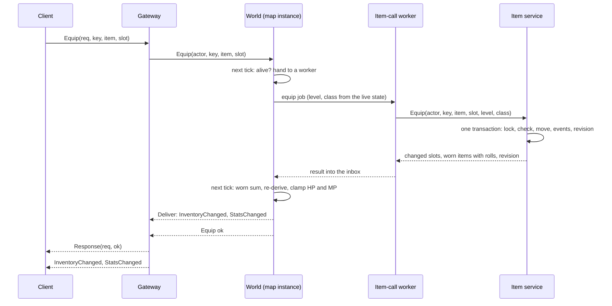

# Equipment, rolled stats, and item details

> **Status: approved · 2026-11-08,** with the defaults of every open question in section 13. The high-level design for [D3. Equipment](../product/features/items-and-inventory/d3-equipment.md), [D6. Character window](../product/features/items-and-inventory/d6-character-window.md), [D7. Item details and comparison](../product/features/items-and-inventory/d7-item-details-and-comparison.md), and the rules in [Systems → Items](../product/systems/items.md). It describes the code as it stands and the change it plans; once built, the page is kept true to the code.
>
> **Superseded in part by [Stat system](stat-system.md):** equipment rolls 20 stats, `attack` and `defense` are now `physical_attack` and `physical_defense`, items may require stats, only weapons keep a class, and the character window previews staged points. Where the two pages differ on stats, that page is the current one.

## 1. What has to hold

From the product pages:

- Ten equipment slots, equip and unequip by double-click or drag, swaps, level and class requirements, nothing lost or duplicated mid-swap.
- Stars 1★–7★ fixed per item type; each copy of an equipment item rolls its stats once, when it drops, and keeps them.
- Stats change right away, and the character window shows the same numbers combat uses, with the equipment's share beside each.
- A hover card for every item, with a second card for the worn item and the change each stat would see.

From the code as it is (the rules this design keeps):

- **The tick never waits on another service.** Anything that needs the item service runs on the world's item-call workers (`itemcalls`, renamed from `economy` in step 0) and comes back into the map instance's inbox, as drop grants do.
- **No transaction spans two services.** An equip or unequip is one transaction in the item service.
- **Rules stay on the server.** The client checks requirements only to decide what to send and what to colour red; the server decides. The client shows the numbers the server sends; its only copy of the stat formulas is the character window's preview of staged points, which the shared stat vectors keep equal to the server's ([Stat system](stat-system.md), section 10).
- **Every item change is an item event and takes the inventory's next revision**, so clients apply changes in order.
- **The protocol only grows.** New messages and fields are additive, so `make breaking` passes and an older client ignores what it doesn't know.

## 2. The change at a glance

| Part | Today | After |
| --- | --- | --- |
| Game data (`server/data/items.yaml`) | Slots `weapon` and `armor`; flat `attack` and `defense` | Nine slot kinds, stars, a description, and a range per stat for equipment |
| Stats (`internal/progression`) | `Equipment{WeaponAttack, ArmorDefense, Penetration}`, always passed empty | `ItemStats` (thirteen stats) summed over worn items; a stat sheet with the equipment's share |
| Item service | Locations `inventory` and `destroyed`; no per-item attributes | An `equipped` location with an equip slot, an insert-only `item_rolls` table, and `Equip` and `Unequip` |
| World service | Knows items only through pickups and the starter safety net | Rolls equipment stats at drop time, loads worn items at join, runs equip and unequip through its workers, re-derives stats |
| Gateway | Routes inventory moves straight to the item service | Routes `Equip` and `Unequip` to the world, with a Response; seven new error codes |
| Client | Inventory window, no tooltip, no stats beyond the five primary | Character window (C key), equipment in the inventory store, a hover card with comparison |
| Character service | Unchanged | Unchanged: it stores level, primary stats, HP and MP; derived stats are never stored |

## 3. Game data

`items.yaml` gains, per item:

- `stars`: 1 to 7, for every item.
- `description`: one line, for every item.
- For equipment, `slot` names a slot kind, one of `weapon`, `hat`, `top`, `bottom`, `gloves`, `shoes`, `necklace`, `earrings`, `ring`, and `stats` lists a range per stat, for example `stats: {attack: [16, 20], str: [0, 2]}`. The flat `attack` and `defense` fields go.

```yaml
- {id: iron_sword, name: Iron Sword, tab: equip, slot: weapon, class: warrior, min_level: 8, stars: 2,
   description: A plain blade that holds an edge., stats: {attack: [16, 20]}}
```

- **Thirteen stats can roll:** `attack`, `defense`, `str`, `dex`, `int`, `agi`, `vit`, `accuracy`, `evasion`, `crit_rate`, `crit_damage`, `max_hp`, `max_mp`. Every value is a whole number. The two rates are in tenths of a percent (`crit_rate: [5, 15]` is 0.5% to 1.5%), so nothing stored is a float.
- **Equip slots versus slot kinds:** a character has ten equip slots, `weapon`, `hat`, `top`, `bottom`, `gloves`, `shoes`, `necklace`, `earrings`, `ring_1`, and `ring_2`. `items.yaml` lists them under `equip_slots`, in the character window's order, each with a name and its kind. A `ring` fits either ring slot; every other kind fits the slot of the same name.
- **Validation** (`internal/gamedata/load`) refuses: stars outside 1–7, a missing or multi-line description, a range whose minimum is above its maximum or below zero, a range that can only roll 0, `stats` on a Use or Etc item, a slot kind no equip slot has, an unknown stat, equipment with no stats, and an equip slot without an id, a name, or a kind, or listed twice.
- **Types:** `gamedata.Item` gains `Stars`, `Description`, and `Rolls`, a struct with one `Range{Min, Max}` per stat; the zero `Range` is a stat the item doesn't give. These are fields, not a map, so sums and validation run in one fixed order, as the stat formulas already do. `Slot` becomes a `SlotKind`.
- **The client** gets all of it through `web/scripts/gen-gamedata.ts`, plus the ten equip slots with their names and kinds (`equip-slots.ts`). Stars, descriptions, requirements, and ranges are static data the client already holds; only a copy's rolled values travel on the wire.

## 4. Stats: one model for the world, the item service, and the client

New types in `internal/progression`, the shared kernel both services already import:

- **`ItemStats`**: thirteen whole numbers, one per stat in section 3. A roll is an `ItemStats`, and so is the sum of everything a character wears.
- **`DeriveStats(formulas, base, level, worn)`** takes the worn sum instead of today's `Equipment`, in this order:
  1. Primary stats are the character's own plus the worn primary stats, so equipment STR feeds attack power through the class's coefficients.
  2. Each derived stat is its formula over those primary stats and the level, plus the worn flat bonus (attack to attack power, defense, accuracy, evasion, the two rates, max HP and max MP).
  3. Caps apply last (crit rate 60%, penetration 50%).
- **`Sheet`** is what the character window shows: the primary and derived totals, and the equipment's share of each. The share is the totals with the worn items minus the totals without them, so a capped rate shows what the equipment really adds.
- **Rolls:** `Rolled(ranges, pick)` builds a roll by picking each stat from its range, every stat in one order; the world picks uniformly with the map's random source. `Lowest` is the bottom of every range, and `ItemStats.Fits` checks a roll against a template's ranges, a stat the item doesn't give only at 0.
- `Equipment.Penetration` goes: no item gives penetration (Systems → Items lists what can roll).

The world computes the sheet, because only the world holds the live level, stats, and worn items. The character service keeps its `Derived()` with no equipment, for the character list over REST.

## 5. Item service: rolls and the equipped location

### Tables (one migration in `services/item/migrations/`)

- **`items`** gains `equip_slot text`.
  - `CHECK ((location = 'equipped') = (equip_slot IS NOT NULL))`. The existing check already makes `tab` and `slot` null outside the inventory.
  - One item per equip slot is the exclusion constraint `one_item_per_equip_slot (owner_id WITH =, equip_slot WITH =) WHERE location = 'equipped'`, deferred to commit. A unique index can't serve: Postgres checks one row by row, and a swap has the new item and the worn one in the slot for a moment, whichever moves first.
  - `items_by_owner` covers `equipped` too, as the reads below do.
- **`item_rolls`**: `item_id` (primary key, references `items`), one `int NOT NULL` column per stat, and `created_at` and `updated_at`, both the item's creation time, as every row carries both stamps.
  - It is insert-only: no query updates or deletes a row. A roll is part of the item for its whole life, which is what D5 means by "what it rolled".
  - It is written in the same transaction as the item's `created` event.
  - One column per stat rather than a JSON column, so sqlc gives typed rows and a later marketplace can filter on a stat.
- **`item_events`** gains two kinds, `equipped` and `unequipped`, each with a quantity delta of 0 and cause `player`, whose ID is the request's idempotency key. Starter equipment worn from the start has a `created` event, then an `equipped` one, both with cause `starter`.

### Contract changes (`api/proto/internal/item/v1/item.proto`)

- `Item` gains `ItemStats stats` (set for equipment) and `equip_slot` (set when worn). `Inventory` returns worn items too.
- `Add` gains `ItemStats stats`. It is required for equipment and refused on anything else; each value must lie within its template's range, else `ErrBadRoll`, which is internal only because no client can cause it. The fingerprint `item.add/1` takes the roll only when set, following the rule beside the fingerprint that a value added later goes in only when set, so old keys still match.
- `GrantStarter` gives starter equipment the lowest value of each range (Systems → Items) and puts it straight into its slot (open question 1), from the step that lets the client show what is worn (section 12). A late grant, from the world's safety net, may find that slot already filled; the item then goes in the Equip tab, as before. The response's `changed` lists only the tab slots, since neither caller reads it.
- **`Equip{actor, idempotency_key, item_id, equip_slot, level, class}`**:
  - `equip_slot` is needed only for rings; left empty, a ring takes the first empty ring slot, otherwise `ring_1`, the same rule the client's comparison uses (D7).
  - `level` and `class` come from the world's live state. The item service checks them against the template, because the requirement belongs to the item, and the world is the only one that knows the level now.
  - The fingerprint (`item.equip/1`) covers the item and the slot, not the level and class: a retry after a level-up is the same request.
- **`Unequip{actor, idempotency_key, equip_slot, to_slot}`**: `to_slot` is optional; empty, it is the first free Equip-tab slot.
- Both answer with the changed inventory slots, the changed equip slots, the full set of worn items with their rolls (so the world can replace its sum outright), and the revision.

### Rules, inside one transaction

- **Locking:** the owner's advisory lock (`LockOwner`) as today, then the owner's inventory and equipped rows, `FOR UPDATE` in ID order. `LockInventory` grows to cover `equipped`.
- **Equip:**
  - The item must be the owner's, in the inventory, and equipment; one already worn answers `ErrItemWorn`.
  - Its slot kind must fit the equip slot, and the level and class must be met.
  - An empty equip slot just receives the item. A filled one swaps: the worn item takes the inventory slot the new one left, so a swap works with a full Equip tab. The new item moves in first, and the slot it left is never free in between, so a drop's grant racing the swap finds the tab still full.
  - Events: `equipped` for the new item and `unequipped` for the old.
- **Unequip:** the slot must hold an item, and the target inventory slot must be free, otherwise `EQUIP_TAB_FULL` or `SLOT_TAKEN`. Event: `unequipped`.
- **A worn item can't be moved or discarded:** `Move` and `Discard` answer the new `ErrItemWorn` instead of today's "not found", so the player is told to unequip first.
- **The revision moves once per change**, through the existing `revised`, so inventory and equipment share one revision counter.
- **Idempotency** works as for `Move`: `idempotencypg.Do` under the account's key, the stored reply returned on a retry, and a reused key with other arguments refused.
- **No outbox notice:** nothing consumes one in Stage 1, and the item events are the history.

### Integrity checks (`services/item/itemtest/invariants.go`)

Checks 5, 6, and 8 hold unchanged. Check 6 already sums every item's quantity whatever its location, so a worn item still counts. New checks:

- **9.** No two worn items share an owner and an equip slot.
- **10.** Every worn item's template fits its equip slot (game data).
- **11.** Every equipment item has exactly one roll; no other item has one. It doesn't compare a roll with its template's ranges: those are enforced where a roll is made or accepted (`Ground.Roll`, `Add`, `GrantStarter`), and retuning a range never changes or invalidates an item already rolled.
- **12.** An item's location agrees with its last `equipped` or `unequipped` event.

## 6. Flows

### A drop rolls its stats

`Ground.Roll` (world, at mob death) already picks each drop's template and quantity with the instance's seeded random generator. For equipment it also rolls each stat within its range, uniformly, and keeps the roll on the in-memory drop. The drop's grant carries it under the drop's key: today `model.Grant`, sent by `item.AddMany` ([Auto pickup and the combat channel](./auto-pickup-and-combat-channel.md)).

- **One roll per drop:** the drop's key is the idempotency key, so a retried `Add` carries the same roll and gets the stored reply. Two players can't both take the drop, because the reservation is unchanged.
- **Replays stay exact:** rolling with the instance's generator, beside the drop table, keeps a recorded fight's loot identical on replay.
- **A world crash before the drop is collected** loses the drop and its roll together, as today: drops live only in memory.
- `DropView` does not carry the roll: ground drops show no details (D7).

### Equip and unequip



- **Why through the world, unlike `InventoryMove`:** two things only the world has. The level check needs the live level, and combat needs the new stats. Sending it straight to the item service would need the level from somewhere else and a second message to tell the world.
- **The world's handler waits; the tick doesn't.** The `Equip` RPC posts a message with a reply channel and waits for the outcome, within the gateway's 5-second limit. The tick only drains the inbox, hands the job to a worker, and later applies the result.
- **On the tick, before the call:**
  - A dead character is refused with `CHARACTER_DEAD`.
  - When no worker is free, the map's inbox is full, or the connection no longer holds the character (mid-transfer, say), the answer is `UNAVAILABLE`: the client may retry, and the key makes the retry safe.
- **On the tick, after the call:**
  - The world replaces the player's worn sum with the one returned, re-derives, and lowers HP and MP to any new maximum (D3). It does so only when the result's revision is newer than the worn sum's, so a result that lands after a rejoin read something newer changes nothing.
  - It marks the player changed, so the next Delta carries the new max HP to everyone on the map.
  - It queues `InventoryChanged` (inventory and equip slots, revision) and `StatsChanged` (the sheet, HP, MP) as the player's private events.
  - It answers the waiting RPC.
- **Ordering:** the gateway's per-connection command queue runs one command at a time, so a player never has two equips in flight. An `InventoryMove` can still interleave, since it goes straight to the item service; the owner's lock serializes the two, and the revision orders what the client shows.
- **Gateway routes:** `Equip` and `Unequip` join `InventoryMove` and `InventoryDiscard` under the shared 5-per-second limit, with `respond`, so the client gets a Response carrying its request ID.

### Join, rejoin, and moves between maps

- **Join:** after the character's `Load`, `World.Join` reads the worn items from the item service (`Inventory` now includes them) and passes the sum to `DeriveStats`.
  - Unlike the best-effort starter call, this read is required. When the item service doesn't answer, the join fails with `Unavailable`, and the gateway's join already retries that with backoff.
  - The sheet goes back in `JoinResponse.CharacterView`, so Welcome carries it.
- **Welcome:** the gateway's `Inventory` call already happens during Hello. Its worn items go into `Welcome.equipment` under the same revision as the inventory.
- **Rejoin after a world restart** reloads the worn items the same way, so combat is right again after the freeze. The client's view doesn't change, since nothing it holds changed.
- **Portals, deaths, and level-ups:** the worn sum travels with the player through `handOff`. Level-up re-derives with it (`progress.go`), as does every landing (`players.go`). Respawn HP is half of the maximum with equipment.
- **An equip in flight keeps the player on its map:** a portal is refused and a respawn away from the map waits until the result settles, so it applies where the player is and the hand-off carries it. An item call takes milliseconds, and at most its 5-second timeout.
- **Checkpoints don't change:** the character service stores HP and MP. Max values are never stored, and a join clamps HP to the maximum it derives.

## 7. Protocol

### Client protocol (`api/proto/client/v1/client.proto`), all additive

| Message | Change |
| --- | --- |
| `Equip` (client) | New: `idempotency_key`, `item_id`, `equip_slot` (rings only) |
| `Unequip` (client) | New: `idempotency_key`, `equip_slot`, optional `to_slot` |
| `ItemStats` | New: the thirteen stats, whole numbers, rates in tenths of a percent |
| `ItemView` | Gains `stats`, set for equipment |
| `EquipSlot` | New: `equip_slot` and an `ItemView`, unset when the slot emptied |
| `Welcome` | Gains `repeated EquipSlot equipment` |
| `InventoryChanged` | Gains `repeated EquipSlot equipment`, under the same revision as the inventory slots |
| `StatSheet` | New: primary totals and the equipment's share; derived totals (attack, defense, accuracy, evasion, crit rate, crit damage, max HP, max MP) and the equipment's share |
| `CharacterView` | Gains `StatSheet sheet`, so Welcome and LevelUp carry it |
| `StatsChanged` (server) | New: the sheet, HP, max HP, MP, max MP |

- Golden files for every new or changed message go in `server/testdata/contracts/`, which the client's protocol tests read too.
- **New error codes**, each with a service reason, an errmap row, a status, its number in `codes.json`, and the client's words:
  - `LEVEL_TOO_LOW` (220014): "Your level is too low for that item.";
  - `WRONG_CLASS` (220020): "Your class can't use that item.";
  - `WRONG_EQUIP_SLOT` (220021): "That item doesn't go there.";
  - `NOT_EQUIPMENT` (220022): "Only equipment can be worn.";
  - `NOTHING_WORN` (220023): "Nothing is worn there.";
  - `ITEM_WORN` (220013): "Unequip it first.";
  - `CHARACTER_DEAD` (330001): "You can't do that while dead."

### Internal contracts

- `item.v1`: as in section 5.
- `world.v1`:
  - new unary `Equip` and `Unequip`, answering when the outcome is applied;
  - `DeliverResponse` gains `StatsChanged`;
  - its `InventoryChanged` gains the equip slots;
  - the `CharacterView` in `JoinResponse` gains the sheet.

## 8. Client

By layer (`web/eslint.config.js`):

- **gamedata:** generated stars, descriptions, slot kinds, ranges, and the ten equip slots.
- **protocol:** regenerated types; `errors.ts` words the seven new codes.
- **net:** `RequestType` gains `equip` and `unequip`; requests keep one idempotency key per attempt, and a retry after a timeout reuses it, as inventory moves do.
- **state:**
  - `inventory` gains `equipment`, one entry per equip slot with a revision per entry, applied by the same rule as inventory slots: a newer revision replaces, an older one is skipped.
  - `character` gains `applyStatsChanged`; the sheet comes in its `CharacterView`, so Welcome and LevelUp set it too.
  - `ui` gains a `character` window.
- **input:** a `character` action bound to `KeyC` in both presets; the World scene toggles the window as it does the inventory.
- **components:**
  - `ItemCard`, presentational only: it takes a template, the copy's view, and an optional comparison, and renders stars, colours, requirements, stats with their ranges, and gains and losses. The thirteen stats' labels and order live beside it, in `item-stats.ts`.
  - A pure helper in `lib` keeps a card fully on screen.
- **features/shared** (allowed by the layer rule, the only folder features can share):
  - an item's name, icon initials, and star colour class;
  - the drag data, and the pending-and-retry handling both windows use for item requests;
  - the hover state, which holds the hovered slot, not its item, so a card follows what the slot holds and leaves with an item that moves;
  - the comparison: which worn item to compare against, with the ring rule, and the difference per stat as if the two were swapped;
  - requirement checks for the red text.
- **features/character:**
  - `CharacterWindow`: the sheet with the equipment's share, and the ten slots around a figure. It opens left of the inventory, so both fit side by side for dragging.
  - Double-click a worn item to unequip; drop an inventory item on a slot to equip.
  - Pending requests and retry work as in the inventory window.
- **features/inventory:** double-click an Equip-tab item to equip. A drag carries the item ID in the drag data, so the character window can take it without either feature importing the other.
- **styles:** a colour token per star count, used for names and icon frames. Icons stay initials until there is item art.
- **game:** each item on the ground is a 32 px shape drawn at load from the item catalog. Equipment is drawn by its slot kind (the weapon by its class) in its stars' colour; a template the client doesn't know gets a generic shape.

## 9. When things fail

| Failure | What the player sees | Why it is safe |
| --- | --- | --- |
| Item service down | Equip answers `UNAVAILABLE`; a join waits and retries | Nothing changed, so a retry is the same request |
| Request times out, the change committed | Retry with the same key gets the stored reply; the world applies it | Idempotency key per request |
| World crashes after the commit, before applying | A short freeze; the rejoin reloads worn items, so stats are right | The item service is the record; the world's sum is a copy |
| Gateway restarts mid-equip | Reconnect; the Welcome shows what is worn | Same as above |
| Item service crashes mid-swap | Nothing changed, or all of it | One transaction; checks 9 to 12 after the crash test |
| Two clients of one account | Can't happen: one session per account | — |

## 10. Testing

- **Game data:** table tests for the new validation rows.
- **Stats:** `DeriveStats` and `Sheet`, table tests plus a property test: the share is total minus total-without, caps hold, and worn primary stats flow through the coefficients.
- **Item service:**
  - Equip, unequip, swap, rings, a full tab, requirements, and a worn item refusing move and discard.
  - A retry gets the stored reply, and a reused key with other arguments is refused.
  - The rapid property test gains equip and unequip operations, with checks 5 to 12 after every run.
  - The crash test (`TestCrashDuringPickups`) gains swaps among its concurrent actions.
- **World:** instance tests with a fake item client:
  - stats change only when the result arrives;
  - a dead character is refused;
  - HP is clamped;
  - level-ups, portals, and deaths keep the worn sum;
  - a join fails over when the item service is down;
  - drops roll within range, and the same seed rolls the same.
- **Gateway:** route rows, errmap rows, and `codes.json`.
- **Contracts:** golden files, and `make breaking` passes.
- **End to end:** one row per D3 and D6 acceptance criterion the server can show (`server/test/equipment_e2e_test.go`), including a swap during a world restart.
- **Client:** Vitest for the equipment store, the comparison and ring rule, and card placement. Testing Library for the character window and for double-click and drag in the inventory.

## 11. Rollout

- **Existing databases:** equipment items already in inventories have no roll. The migration that adds `item_rolls` gives each one, destroyed ones too, its template's lowest roll, the same rule as starter items, so check 11 holds from the first start (open question 2). It lists the six equipment templates items.yaml had and their lowest values, because migrations run without the game data. Those values stay as rolled: retuning a range never changes or invalidates items already rolled.
- **Data:** Leather Cap becomes a `hat` and Leather Vest a `top`. The content step brings `items.yaml` to an armor or accessory for every slot kind, and a weapon per class, in each level band (1 to 9, 10 to 19, 20 to 29), 33 pieces of equipment in all, from 1★ to 4★ and one 6★ ring. A test on the real data keeps it so, and checks that every piece drops from a mob or is a starter.
  - The forest's mushrooms drop the first band's armor and accessories; the cave's boars and bats drop the second band's, the weapons of levels 8 to 14, and, rarely, the third band's.
  - The third band waits for a map with mobs of its levels; until then it is a rare find in the cave (0.2% to 0.4% a kill), as is the 6★ Moonstone Ring.
  - Green slimes keep their drops, so a new player's first kills fill the Etc and Use tabs as before.
- **Balance:** equipment bonuses have never applied in combat. Even a starter sword adds attack (+48% attack power for a level 1 warrior), so the content step raises mob HP until the weapon a player of the mob's level likely holds kills it in as many hits as before (open question 3): green slime 30 to 44, orange mushroom 70 to 90, wild boar 180 to 216, cave bat 150 to 180. Mob attack stays, so armor makes mobs hit softer, as it should.
- **Deploy order:** item service first, then world, then gateway, then the client. The item service answers old callers as before, except an old world's pickup of equipment, which carries no roll: it is refused and the drop stays on the ground until that world restarts, seconds later in a release. Old clients ignore the new fields and never send `Equip`.
- **An old item service beside the new schema:** an item service from before rolls, running against a database the migration has reached, writes equipment with no roll, as starter grants and pickups. Every read gives such an item its template's lowest roll, so it never counts as zero. The owner's next change writes that roll and logs a warning, so check 11 holds again and a later retune doesn't move it.

## 12. Build order

Each step is one reviewed commit, green on `make test`, `make lint`, and `make cover`:

0. **Rename the economy workers to `itemcalls`:**
   - Package `services/world/internal/application/economy` becomes `itemcalls`, and `Workers` becomes `Pool`. The name says what every job is: a call to the item service, which stays true when currency joins the item service in Stage 2.
   - The config key `economy.workers` becomes `item_calls.workers` (now `FINGA_WORLD_ITEM_CALLS_WORKERS`, under the world's section), with `server/.env.example` and the config tests to match.
   - The metric `finga_economy_jobs_inflight` becomes `finga_item_calls_inflight`, with the Grafana dashboard in `infra/obs` updated in the same commit.
   - No behaviour changes.
1. **Game data:** stars, descriptions, slot kinds, ranges, validation, and the client generator. No behaviour changes.
2. **Stats model:** `ItemStats` and `DeriveStats` over the worn sum, in `internal/progression`. `Sheet` comes with its first caller, the world, in step 5.
3. **Item service, rolls:** the `item_rolls` table, `Add` with a roll, starter items at the lowest roll, check 11, and the backfill. The world rolls at drop time in the same step, since `Add` refuses equipment without a roll.
4. **Item service, equipping:** the `equipped` location, `Equip` and `Unequip`, worn items refusing move and discard, checks 9, 10, and 12, and the property and crash tests (the crash test swaps through the item service, as no client route exists yet). The item service's six new error codes reach the client in this step, since `ITEM_WORN` can already answer a move. The gateway and the world leave worn items out of their inventory views until they show and use them.
5. **World:** worn items at join, `Equip` and `Unequip` through the workers, the `Sheet`, re-derive and `StatsChanged`, with `CHARACTER_DEAD` reaching the client as its reason arrives.
6. **Gateway and protocol:** routes, Welcome and InventoryChanged with equipment, the contracts, and starter equipment worn from the start, now that the client shows it.
7. **Client, character window:** stores, the C key, the window, and equipping by double-click and drag.
8. **Client, item card:** the hover card and the comparison.
9. **Content and balance:** the new items, drop lists, and tuning.

## 13. Open questions

Approved on 2026-11-08 with every default below.

1. **Starter equipment worn from the start.** Default: yes, so a new player fights with their weapon without first learning to equip it. Otherwise it lands in the inventory, as today.
2. **Existing equipment.** Default: backfill each piece with its lowest roll. The alternative is recreating the database (`make down`), as the split required. The backfill went when each service's migrations were squashed into one file on 2026-11-12: until go-live, a breaking change starts from a fresh database.
3. **Balance.** Default: retune mobs in the content step. The alternative is lowering the class formulas so a starter weapon brings damage back to today's level.
4. **Character list.** Default: the REST character list keeps showing stats without equipment. Showing them would mean the character service reading worn items from the item service.

## 14. Alternatives considered

- **Equip straight to the item service, then tell the world:** shorter for the item service, but the level check would need the live level, and a lost notice would leave combat wrong until the next join.
- **The item service rolls, seeded by the drop's key:** keeps the world out of stat ranges, but splits one drop's randomness across two services and breaks the exact replay of a recorded fight.
- **Rolls as a JSON column on `items`:** one table fewer, but untyped rows, and no index for a later marketplace filter.
- **The client computes derived stats from generated formulas:** no new message, but a copy of a server rule, and it would drift from combat.
