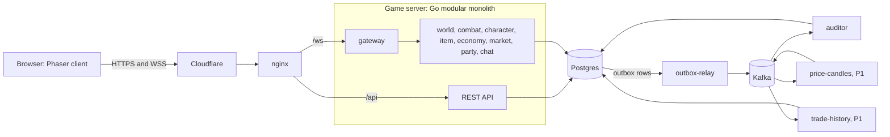
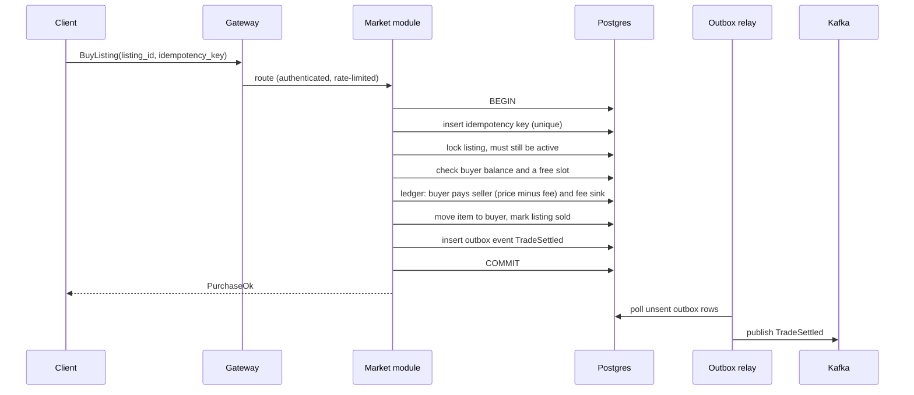

# High-level design

> 🧭 **Status: draft v0.1 · 19 Oct 2026.** The target architecture: how the system looks once complete. What gets built in which stage is in [Roadmap](./roadmap/README.md). What the game does is defined in the product docs, starting from [Overview](../product/overview.md). Where a product decision is still open, this design assumes its current default (for example fixed-price market listings, and players allocating their own stat points).

# 1. Context and goals

## Technical goals

- **Real-time and server-authoritative:** the server owns combat, mobs, and movement validation.
- **Economic correctness:** no item or currency can be duplicated or lost, even under crashes and retries.
- **Durable event pipeline:** transactional outbox, idempotent consumers, and exactly-once processing on Kafka.
- **A clear path to horizontal scaling:** channels spread across nodes, with seamless player handoff.
- **Observable:** every claim about latency, capacity, and correctness is backed by metrics and load tests.
- **Reusable building blocks:** non-domain code lives in generic packages that could ship in another project unchanged.

## Technical non-goals for the MVP

- Kubernetes, service mesh, or multi-region.
- One microservice per domain from day one.
- A custom proxy, custom networking stack, or 3D.
- Real money or payment providers.

# 2. From requirements to design

| Requirement | Source | Design response |
| --- | --- | --- |
| Players see each other move smoothly | B2 | 20 Hz authoritative tick per map; client predicts its own movement and interpolates others |
| Combat results are the same for everyone and can't be faked | C2 | Server resolves hits and damage; the client only sends intents |
| Items and currency are never duplicated or lost | D5, F1 | Postgres transactions, double-entry ledger, unique item IDs, idempotency keys, auditor |
| A market purchase settles exactly once | F3 | One database transaction with a row lock and an idempotency key |
| Every change can be traced | D5, F1 | Append-only ledger entries and item events, published as domain events |
| Progress survives logout and restarts | D2 | Economic state written synchronously; other progress checkpointed |
| Party and chat work across maps | E1, E3 | In-process in the MVP; NATS once maps span nodes |
| Spam and brute-force protection | A1, E1 | nginx limits per IP; gateway token buckets per account |
| Playable public demo | Project goal | Cloudflare, then nginx, then one VPS running Docker Compose |
| 1,000 concurrent players on one node | Project goal | Each map instance owned by one goroutine; bot load tests |

## Targets

- **Capacity:** 1,000 concurrent players on one game server node.
- **Tick:** 20 Hz per map instance, with tick processing p99 under 25 ms (half of the 50 ms budget).
- **Latency:** input to visible result under 150 ms for players in the region, network included.
- **Economic durability:** zero loss of committed economic state. Positions and HP may roll back a few seconds after a crash.
- **Correctness:** the auditor reports zero mismatches after load and chaos tests.
- **Availability:** best effort, single region. A server restart sends players back to log in; they reconnect and resume.

# 3. Architecture overview



nginx also serves the client's static files on `/`. Prometheus scrapes every Go process; Grafana shows the dashboards.

# 4. Components

| Component | Responsibility | Technology |
| --- | --- | --- |
| **Client** | Rendering, input, own-movement prediction, interpolation, menus | Phaser 4, TypeScript, Vite; React overlay for menus and the HUD, sharing a Zustand store with the game; Tiled maps (TD-23) |
| **Cloudflare** | Absorbs attacks, hides the origin IP, caches static files | Free plan, managed with Terraform |
| **nginx** | TLS to the origin, static files, routing, per-IP limits, WebSocket upgrade | nginx with a Cloudflare origin certificate |
| **Game server** | All gameplay and economy logic | Go modular monolith, `cmd/gameserver` |
| **Outbox relay** | Publishes committed outbox rows to Kafka | Go, `cmd/outbox-relay`, generic |
| **Kafka** | Durable, ordered, replayable domain events | Apache Kafka in KRaft mode; franz-go client |
| **Consumers** | Audits and read models built from events | Go, one binary each |
| **Postgres** | System of record | Postgres with pgx, sqlc, and goose |
| **Observability** | Metrics, dashboards, logs | Prometheus, Grafana, structured JSON logs |
| **Bot client** | Load and chaos testing over the real protocol | Go, `cmd/bot` |

## Game server modules

Each module owns its own tables and exposes a Go interface. No module reads or writes another module's tables.

- **gateway:** WebSocket sessions, auth handshake, protocol version check, one active session per account, per-account rate limits, routing to map instances, fan-out.
- **account:** sign up, log in, sessions (REST).
- **character:** creation, classes, stats, levels, EXP.
- **gamedata:** loads static data at startup: classes, stat rules, mobs, items, drop lists, the EXP curve, and maps.
- **world:** map instances, the tick loop, movement validation, portals, mob spawning and behavior, ground drops.
- **combat:** hit and damage resolution, crits, death, EXP awards.
- **item:** item instances, inventory, equipment, pickup.
- **economy:** wallets on a double-entry ledger; NPC shops later.
- **market:** listings, search, purchase settlement, expiry.
- **party** and **chat.**

## Consumers by phase

- **First: auditor.** Reconciles ledger and item totals and flags any mismatch (D5, F1). Until it exists, the same checks run inside the tests.
- **P1: trade-history** (sale history per item) and **price-candles** (Kafka to Kafka with transactions), both for F5.
- **P2: leaderboard** (F6).

# 5. Real-time model

- One goroutine per map instance owns that map's state. Other code talks to it only by sending it messages, so game state needs no locks.
- Fixed 20 Hz tick: drain inputs, validate movement, update mobs, resolve combat, then send deltas to everyone on the map.
- **Movement:** the client simulates its own character and sends inputs with sequence numbers. The server re-checks speed, bounds, and collisions against the same Tiled map data, and corrects the client when needed. Other players are drawn about 100 ms behind, with interpolation.
- **Combat:** the client sends intents, such as "attack facing left." The server decides hits from class range and hitboxes.
- **Who receives updates:** the whole map, since MVP maps are small. A spatial grid comes in only if maps grow.
- **Ephemeral state:** positions, mobs, and ground drops live only in memory. A ground drop becomes a real item only when someone picks it up.

# 6. Key flows

## Log in and enter the world

1. The client calls `POST /api/sessions` and receives an opaque session token.
2. The client picks a character, then opens `/ws` with the token.
3. The gateway validates the token, ends any older session for the account, loads the character from Postgres, and attaches the player to its map instance.
4. The map instance sends a full snapshot, then deltas every tick.

## Kill, EXP, and loot

1. Combat resolves a kill inside the tick, and EXP is applied in memory. Level-ups are saved immediately; EXP is checkpointed (TD-02).
2. Drops appear on the ground, in memory.
3. A pickup runs one database transaction: create the item instance (or add to a stack) and write an item event, or move currency from the system mint account to the player's wallet; insert the outbox event; commit. Only then does the client see the item.

## Market purchase



- A retried request hits the same idempotency key and returns the original result instead of buying twice.
- When two buyers race for one listing, the row lock lets exactly one win.

## Map change

- **MVP:** the player moves between map goroutines in the same process, and progress is checkpointed.
- **Later:** maps run on different nodes. The gateway keeps the client's WebSocket open and re-attaches it to the new node, so the player never sees a disconnect.

# 7. Data design

## Where data lives

- **Postgres:** the system of record, in one schema (TD-22). Each module owns its tables (accounts, characters, items, ledger, listings), alongside shared outbox and idempotency tables, and read-model tables in Stage 2.
- **Kafka:** domain events. Not the system of record.
- **Memory:** ephemeral world state.
- **Repo files:** static game data (YAML or JSON) and Tiled maps, versioned with the code and shared by client and server.

## Ledger

- Every currency movement is one transaction of two or more entries that sum to zero.
- System accounts: **mint** (drops, NPC sales) and **sink** (fees, NPC purchases).
- Each wallet's balance is stored and updated in the same transaction, with a database constraint that it never goes below zero.

## Items

- Each equipment piece has a unique ID (UUIDv7). Stackable items are quantities per slot.
- Each item has exactly one location: inventory, equipped, or listed.
- Every create, move, and destroy appends an item event. This is the full history D5 asks for.

## Events

- One topic per domain: `economy.events`, `item.events`, `character.events`. Keyed by aggregate ID, so events for one wallet or one item stay in order.
- Event schemas are Protobuf, in `api/proto`. Every event carries a unique event ID for deduplication.

# 8. Protocols

- **REST with JSON** for account and character select.
- **WebSocket with binary Protobuf** for gameplay.
  - Client to server: inputs with sequence numbers, and actions (attack, pickup, chat, party, market). Commands that change economic state carry an idempotency key.
  - Server to client: snapshots, deltas tagged with tick numbers, events (damage, death, level-up), and acknowledgements.
- Schemas live in `api/proto` and are generated for Go and TypeScript with buf. `api/` also holds the REST contract (`openapi.yaml`) and the WebSocket message catalogue (`asyncapi.yaml`). Breaking-change checks in CI keep older clients working.
- **Internal:** Go interfaces in the MVP, NATS between nodes after the split, Kafka for durable domain events.

# 9. Correctness and failure handling

- An economic change never exists only in memory. Each one is a single Postgres transaction with row locks, constraints, and an idempotency key.
- Events leave through the outbox, so a committed change always produces its event, and an uncommitted one never does.
- Consumers are idempotent: they record processed event IDs in the same transaction as their own writes.
- Kafka-to-Kafka processing (price-candles) uses Kafka transactions with `read_committed`.
- **Auditor invariants:** all ledger entries sum to zero; each wallet equals the sum of its entries; each item has exactly one location; item counts match item events.

| Failure | Effect | Recovery |
| --- | --- | --- |
| Game server crash | In-memory world lost: positions, mobs, ground drops | Players reconnect; economic state intact; progress from the last checkpoint |
| Outbox relay crash | Events delayed, not lost | Restarts and resumes from unsent outbox rows |
| Kafka down | Events queue up in the outbox | The relay drains the backlog when Kafka is back |
| Consumer crash | Read models fall behind | Resumes from its committed offset; replays are deduplicated |
| Postgres down | Economic actions fail safely; gameplay degraded | Restore; nothing is ever half-applied |

# 10. Security

- Cloudflare in front; the origin firewall accepts only Cloudflare's IP ranges; Full (strict) TLS with an origin certificate.
- Passwords hashed with argon2id. Opaque session tokens, stored hashed and revocable.
- **Rate limits:** nginx per real client IP before login (`limit_req` on login, `limit_conn` on WebSockets); gateway token buckets per account and message type after login.
- The server validates every action. The client is never trusted.
- Chat messages are length-limited and sanitized.

# 11. Observability

- **Metrics:** tick duration, players per map, messages per second in and out, WebSocket connections, database transaction latency, outbox backlog, consumer lag, and auditor mismatches (must stay at zero).
- **Logs:** structured JSON with request and session IDs.
- **Dashboards:** Grafana. The README links screenshots and load-test results.
- **Tracing:** OpenTelemetry, later.

# 12. Reusable building blocks

Non-domain code goes in `/pkg` as generic libraries with no knowledge of the game. `/pkg` never imports `/internal`.

- `pkg/ledger`: double-entry ledger engine (accounts, transfers, invariants).
- `pkg/outbox`: transactional outbox writer and relay, with a pluggable publisher.
- `pkg/idempotency`: idempotency-key store for command handlers.
- `pkg/consumer`: Kafka consumer runner with deduplication, retries, and a dead-letter topic.
- `pkg/ratelimit`: keyed token buckets.
- `pkg/auth`: authentication interface (verify credentials, issue, validate, and revoke sessions). The built-in account module implements it today; an identity provider such as Keycloak can replace it later (TD-17).
- `pkg/tick`: fixed-timestep loop runner.
- `pkg/wsconn`: WebSocket session handling (read and write loops, pings, backpressure).
- `pkg/observability`: logging and metrics setup (TD-21).
- `pkg/configload`: typed YAML configuration with environment overrides, validated at start. Copied from docviewer, without its .env loader: Compose and make inject server/.env into the environment.

# 13. Repository layout

Follows the layout of [zranitm/docviewer](https://github.com/zranitm/docviewer) (TD-20). The full tree, with what each folder holds, is in the Low-level design, page 1.

```txt
server/         the Go module, and everything the server builds, reads and publishes
  api/          REST contract, WebSocket catalogue, Protobuf schemas
  cmd/          gameserver and migrate; outbox-relay, auditor, other consumers, and bot in Stage 2; each binary wires its own dependencies next to its main
  configs/      YAML defaults for each binary
  data/         game content and Tiled maps, which the client generates from
  internal/     application (the game's business logic), handlers (REST, the gateway, the route table)
  migrations/   goose migrations
  pkg/          generic libraries (section 12)
  test/         end-to-end tests, one row per acceptance criterion
  testdata/     shared movement vectors, golden messages, error codes
  Dockerfile    the image for every binary
web/            Phaser client
infra/          how it runs: docker-compose today; nginx config, Grafana dashboards, and Terraform for Cloudflare later
docs/           the design (product and tech), the AI coding log, the proof-session checklist
tools/          developer tools; empty in Stage 1
```

The repository was split into these three parts on 2026-10-23, at the user's request, for a clearer organization.

Decision records live in `docs/tech/decisions/` (and `docs/product/decisions/`), beside the other design pages. The design moved from Notion into `docs/` on 2026-10-23; these files are the source of truth.

# 14. Deployment and CI

- **Local and demo:** Docker Compose with nginx, the game server, outbox relay, consumers, Postgres, Kafka (one KRaft broker), Prometheus, and Grafana.
- **Demo host:** one VPS behind Cloudflare.
- **CI (GitHub Actions):** Go tests with the race detector, golangci-lint, buf lint and breaking checks, the client build, integration tests against real Postgres and Kafka (Testcontainers), and container image builds.

# 15. Scaling path

Each step happens only when a metric shows it's needed.

1. **MVP:** one game server process, one channel per map.
2. **Channels (B4):** more map instances in the same process.
3. **Split the gateway** into `cmd/gateway` and run several channel servers. The gateway routes each player by map and channel and handles handoff. NATS carries party, chat, and whispers between nodes.
4. **Split economy and market** into their own service, add Postgres read replicas, and move Kafka to three brokers.

# 16. Testing strategy

- Unit tests, table-driven.
- Property-based tests for the ledger and market: random transfers and purchases never break the invariants.
- Shared movement test vectors: the same inputs must give the same result in the Go and TypeScript movement code.
- Deterministic tick tests: replay recorded inputs and compare the resulting state.
- Integration tests against real Postgres and Kafka.
- Load tests with `cmd/bot` up to the 1,000-player target.
- Chaos tests: kill the server, relay, consumers, or Kafka mid-flow, then run the auditor. It must find zero mismatches.

# 17. Technical decisions

Open and decided technical questions live in [Tech decisions](./decisions/README.md), each with its options, default, and outcome. Where this page refers to TD-01 to TD-08, it uses their current defaults.

# 18. Risks

- **Movement code in two languages can drift.** Mitigation: shared test vectors run in CI for both.
- **Scope:** four classes in the MVP multiply combat content and balancing work.
- **Single VPS:** a host failure takes the demo down. Acceptable for a portfolio.
- **Kafka's operational weight:** one broker locally, three only when needed.
