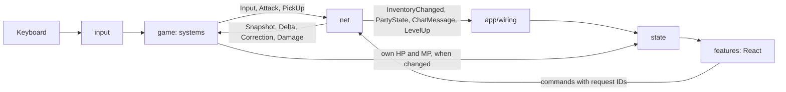

# 7. Client

> 🔎 Based on Phaser's official Vite and React templates, the bulletproof-react guide, and current tool docs, checked October 2026. Sources are at the end of the page.

## Stack

| Tool | Version | Why |
| --- | --- | --- |
| **Phaser** | 4.x (4.2 is stable) | Current major. Phaser's official templates are already on Phaser 4. |
| **TypeScript** | 6.x, pinned | TypeScript 7.0 (August 2026) has no programmatic API until 7.1, so typescript-eslint can't run on it yet. Move to 7 once typescript-eslint supports it. |
| **Vite** | 8 | Current major. One bundler (Rolldown) for both dev and build. |
| **React** | 19 | The HTML overlay for menus and the HUD. Phaser publishes an official React template, and React has the most learning material (TD-23). |
| **Zustand** | 5 | A small store that works inside and outside React: Phaser code uses `getState` and `subscribe`, React components use `useStore` with a selector. |
| **Vitest** and **Testing Library** | Vitest 4 | Vitest reuses the Vite config and supports Vite 8 since 4.1. Testing Library tests components the way a player uses them. |
| **ESLint** and **Prettier** | ESLint 9, flat config | typescript-eslint's `recommendedTypeChecked` and `stylisticTypeChecked`, the React hooks rules, and import rules for the layers below. Prettier formats. |
| **Node.js** and **npm** | Node 24 LTS | Pinned in `.nvmrc`, with the lockfile committed. Move to Node 26 once it enters LTS (late October 2026). |

Not copied from the official templates:

- `log.js`, which sends a request to Phaser's servers on every dev and build run.
- Two separate Vite configs: one `vite.config.ts` is enough.
- terser: Vite's default minifier is fine.
- The legacy `.eslintrc.cjs`: ESLint 9 uses `eslint.config.js`.

## Layout

```txt
web/
  index.html              page shell: the game canvas and the UI root
  package.json  package-lock.json  .nvmrc
  tsconfig.json           strict; the "@/" alias points at src/
  vite.config.ts          dev proxy for /api and /ws; Phaser in its own chunk
  eslint.config.js  .prettierrc
  public/
    assets/               images, spritesheets, audio, fonts, served as-is
    maps/                 copied from ../server/data/maps before dev and build; git-ignored
  src/
    main.tsx              entry: mounts the React app
    app/                  composition root: App.tsx, screen flow, PhaserGame.tsx, wiring.ts
    config/               env.ts: typed access to import.meta.env
    gamedata/             generated from ../server/data before dev, build, typecheck, and test; git-ignored
    lib/                  generic helpers with no game knowledge: vec2, ring buffer, backoff, fixed-step accumulator
    protocol/             message types and the codec interface; JSON now, generated Protobuf in Stage 2
    sim/                  movement simulation, a mirror of the Go code
    net/                  REST client; WebSocket client with Hello, request IDs, idempotency keys, reconnect
    state/                Zustand stores: session, character, inventory, party, chat, connection, settings, ui
    input/                key presets (Classic, WASD) mapped to actions
    components/           shared UI pieces: Button, Window, Bar, Modal
    game/                 everything Phaser
      main.ts             game config and start function
      keys.ts             scene, asset, and animation keys as constants
      scenes/             boot.ts, preloader.ts, world.ts
      entities/           views: player, mob, drop, damage number
      systems/            prediction and reconciliation, interpolation, input sender
    features/             React UI, one folder per feature
      auth/               sign up and log in
      characters/         create and pick a character
      hud/                HP, MP, and EXP bars, level, party panel
      chat/  inventory/  party/  settings/
      shop/  market/      Stage 2
    styles/               global CSS and design tokens
    testing/              test helpers (fake WebSocket, store reset); imported by tests only
```

Tests sit next to the code they test, as `*.test.ts` or `*.test.tsx`.

## Dependency rules

Code flows one way, from generic to specific, as in bulletproof-react. Each layer imports only from the layers above it, and folders in the same layer don't import each other.

```txt
1  lib  config  gamedata
2  protocol  sim
3  net  state  input  components
4  game (Phaser)      features (React)
5  app
```

- `sim` is pure TypeScript with no Phaser, React, or DOM, so Vitest runs it exactly as `go test` runs the Go version.
- `gamedata` is data only, generated from `server/data/*.yaml`: movement constants, the EXP curve, item templates, class attack cooldowns, and mob types. The client shows these and uses them to decide whether to send a command; it never rules with them. Nothing in `server/data/` is typed by hand on the client.
- `game` and `features` never import each other. They meet in `state` and `net`.
- No feature imports another feature; `app` composes them.
- `net` and `state` don't know each other either: `app/wiring.ts` connects incoming messages to store actions, so each can be tested alone.
- No barrel (`index.ts`) files. Import the file directly; barrels slow Vite down and defeat tree-shaking.
- Enforced by ESLint with `import-x/no-restricted-paths`, so a wrong import fails `make lint`.

## How the pieces talk



- Per-tick world data (positions, mobs, drops) stays inside `game/systems` and never goes through the store, so React doesn't re-render 20 times a second.
- The store holds what menus and the HUD show: HP, MP, EXP, level, inventory, party, chat, connection status, and settings. Components subscribe with selectors, so each re-renders only when its slice changes.
- There is no global event bus. Phaser's React template uses one, but untyped string events are easy to mistype and hard to trace. Typed stores and the typed `net` client replace it.

## Phaser and React together

- `app/PhaserGame.tsx` creates the Phaser game once on mount and destroys it on unmount, as in Phaser's React template. The guard also covers React's development-mode double mount.
- The React overlay sits over the canvas. Its root has `pointer-events: none`, and windows and buttons turn pointer events back on, so clicks anywhere else reach the game.
- While a text field or window has focus, the store's `ui.captureKeyboard` is set, and the game ignores movement keys.
- Login and character screens are React only. Boot and Preloader load assets in the background meanwhile, and the World scene starts when the player enters the world.

## Phaser conventions

- One scene per file. Scenes stay thin and hand their work to systems.
- Scene, asset, and animation keys are constants in `game/keys.ts`. Mistyped string keys are a common Phaser bug.
- Entities are views: they draw the state they're given and own no game rules.
- Prediction and interpolation are functions over plain data, so they're tested without Phaser.
- Tiled maps are validated by the Go `gamedata` tests in CI, so the client loads the same files without checking them again.
- A map change restarts the World scene for the new map (C12, decision 142): the collision view, the interpolation buffers, every entity view and the predictor are rebuilt from nothing and the following Snapshot places everyone, so nothing stale can survive a hop. That is the cost of a hop in Stage 1 (one fade and one Snapshot); Stage 2's interest management starts from it.

## Frame loop

- Phaser renders at the display's refresh rate. A fixed 1/60 s accumulator runs `sim/` for the local player; every third sub-step starts a 50 ms tick, as on the server.
- **Prediction:** held keys are sampled once per tick, and that sample is both the tick's Input and the input for the tick's 3 sub-steps, so the client simulates exactly what the server will (the server applies one Input per tick in sequence order, backend step 18). A jump pressed and released inside one tick counts as held for that tick. Keys take effect at the next tick boundary: up to 50 ms, the price of an exact match. The client keeps the last 2 seconds of inputs and predicted states by sequence number.
- **Reconciliation:** on each Delta, compare the server's state for `ack_seq` with the predicted one. If they differ by more than 4 px, or on a Correction, reset to the server state and replay the unacknowledged inputs.
- **Other players and mobs:** buffer server states and render 100 ms in the past, interpolating between the two nearest.

## Sending

- Input is sent once per tick (50 ms) while in the world, with that tick's sampled keys, even when nothing changed, so `ack_seq` always names one tick on both sides.
- When keyboard capture starts (a text field or window takes focus), an all-released Input goes out at once, so the character stops instead of walking on while the player types.
- Attack, PickUp, and EnterPortal are sent right away with the current sequence number.
- Item actions generate one idempotency key per click and reuse it on retry.

## Connection loss

Show a reconnecting notice, reconnect with backoff, and send Hello again. The server treats it as a fresh join at the last saved position. A request still waiting for its Response is re-sent once on the new connection, with the same idempotency key.

## Session token

One holder in `net`, read by both the REST client and the socket: the token from login, then the one from each Welcome. It is replaced only when a Welcome arrives and lives in memory only (page 4, Trust model), so a reload means logging in again. Nothing else keeps a copy: a REST call with the token from before the last Hello works once within 60 seconds and then revokes the whole session.

## Screens

- Login and character creation are React screens shown before the World scene.
- The HUD sits over the World scene: HP, MP, and EXP bars, level, chat, and the party panel. Coins join in Stage 2.
- Windows open by key: I for inventory, P for party. The shop and marketplace open from town NPCs in Stage 2.

## Settings

The control preset is saved to the account with `PUT /api/settings` (B6) and cached locally for a fast start.

## Assets

Kenney CC0 images and spritesheets under `public/assets/`, loaded as they come in Stage 1; packing them into texture atlases waits until the asset count calls for it. The art is Kenney's "Platformer Pack Remastered" (128 px tiles, enemies and backgrounds, 128x256 players), drawn at scale 0.25 so one tile is one 32 px grid cell and nothing blurs; the two potions are tinted flasks from "Generic Items", and the other item templates are 32 px shapes drawn at runtime in the same palette, listed as original in `LICENSES.md` (C07, decisions 119 and 120).

The Tiled maps hold only object layers (solids, platforms, ropes, portals, spawns, the player spawn) and no tile art, so the World scene draws each object with a repeating Kenney texture. The maps are copied from `server/data/maps` before each dev and build run: the same files the server reads.

## API origin

The client reads the game server's origin from `VITE_API_ORIGIN`, through `config/env.ts`. Empty means same origin, which is the case behind the Vite proxy in development and behind nginx in Stage 2.

## Conventions

- File names in kebab-case (`inventory-window.tsx`); components and classes in PascalCase.
- Absolute imports through `@/`, for example `@/net/socket`.
- Strict TypeScript; `any` is a lint error.
- Prettier formats and ESLint checks. Both run in `make lint`.

## Scripts

- `package.json`: `dev`, `build`, `preview`, `typecheck`, `lint`, `format`, `test`, and `coverage`. `predev`, `prebuild`, `pretest` and `precoverage` copy the maps and generate `src/gamedata/` (the game tests read the maps from `public/maps`); `pretypecheck` and `prelint` generate it too.
- The Makefile calls these through `npm --prefix web`, so `make test` and `make lint` cover the client too.

## Tests

Table-driven, like the Go tests: `test.each` with named cases.

- **`sim`:** the shared movement vectors in `server/testdata/movement/`.
- **`protocol`:** decode and re-encode every golden message in `server/testdata/contracts/`, and check the error code list against `server/testdata/errors/codes.json`. The Go tests read and write the same files, so both sides agree on the wire format.
- **`net`:** with the fake WebSocket from `testing/`: responses matched to requests, retries reusing the idempotency key, and reconnect backoff.
- **`game/systems`:** reconciliation and interpolation over plain data.
- **`features`:** Testing Library for forms and windows, such as login validation and inventory actions.
- **Coverage:** an 80% floor on `lib`, `protocol`, `sim`, `net`, `state`, and `game/systems`. Scenes, entities, and components are checked by playing.
- **Stage 2:** one Playwright smoke test: sign up, enter the world, move, and pick up an item.

## Sources

- [Phaser Vite TypeScript template](https://github.com/phaserjs/template-vite-ts) and [Phaser React TypeScript template](https://github.com/phaserjs/template-react-ts)
- [Phaser 4.2 release](https://phaser.io/news/2026/07/phaser-4-2-spine-renderer-mesh2d-stencil)
- [bulletproof-react: project structure](https://github.com/alan2207/bulletproof-react/blob/master/docs/project-structure.md)
- [typescript-eslint shared configs](https://typescript-eslint.io/users/configs)
- [TypeScript 7.0 release (InfoQ)](https://www.infoq.com/news/2026/08/typescript-7-released/)
- [Vite 8.1](https://vite.dev/blog/announcing-vite8-1) and [Vitest 4.1](https://main.vitest.dev/blog/vitest-4-1)
- [Zustand vanilla stores](https://zustand.docs.pmnd.rs/apis/create-store)
- [Node.js release schedule](https://endoflife.date/nodejs)
- [What are Phaser best and bad practices? (Phaser forum)](https://phaser.discourse.group/t/what-are-phaser-3-bad-best-practices/5088)
- [Gabriel Gambetta: client-side prediction and server reconciliation](https://gabrielgambetta.com/client-side-prediction-server-reconciliation.html) and [entity interpolation](https://gabrielgambetta.com/entity-interpolation.html)
