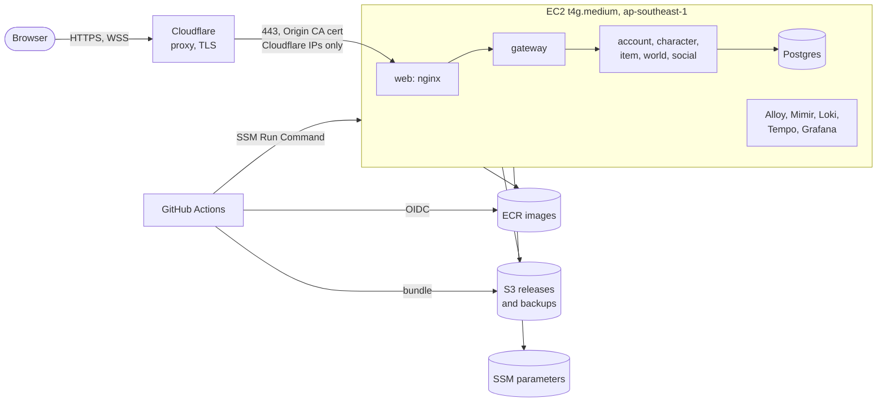

# Deploying Finga to AWS

The game runs in production the way `make up OBS=1` runs it locally: the same Compose file, the same images,
on one EC2 instance in Singapore behind Cloudflare. This directory holds what runs on that instance;
`infra/terraform` creates the instance and everything around it; `.github/workflows/deploy.yml` ships `main`.



| Piece | Where | Why there |
|---|---|---|
| The six services, migrations, nginx | ECR images tagged with the commit SHA | The services ship together: one SHA, every image |
| Compose files, nginx TLS include, deploy scripts | `infra/` as a tarball in S3, one per SHA | The deploy logic always matches the release it deploys |
| Postgres password, Origin CA key and cert, nginx real-IP list | SSM Parameter Store (SecureString) | Nothing secret in the repo or the images |
| Postgres data | A Docker volume on the instance's encrypted EBS volume | Nightly `pg_dump` to S3 and daily EBS snapshots |
| Grafana | `127.0.0.1:3000` on the instance | Anonymous admin, so never public: reach it through an SSM tunnel |

Nothing listens to the internet except nginx on 443, and the security group lets only Cloudflare's ranges reach it.
There is no SSH: you and CI reach the instance through SSM.

## What it costs

Roughly, in `ap-southeast-1`, on demand:

| Item | Per month |
|---|---|
| `t4g.medium` (2 vCPU, 4 GB) | ~$31 |
| 40 GB gp3 root volume | ~$4 |
| Public IPv4 (the Elastic IP) | ~$3.60 |
| Snapshots, ECR, S3, alarms | ~$2 |
| Cloudflare (free plan) | $0 |
| **Total** | **~$40** |

Data to Cloudflare counts as internet egress, free for the first 100 GB a month. New accounts' Free Tier credits
cover the first months. Choose the **Paid** plan at sign-up, though: a Free plan account closes when its credits or
its six months run out.

## Before you start

- An AWS account, and the AWS CLI v2 signed in as an administrator: `aws configure sso` with IAM Identity Center,
  not root keys. Set an AWS Budgets alert (say $20 and $50) while you are in the console.
- The [Session Manager plugin](https://docs.aws.amazon.com/systems-manager/latest/userguide/session-manager-working-with-install-plugin.html) for the AWS CLI.
- Terraform 1.10 or newer, `jq`, and `gh` signed in to the repository.
- A domain on Cloudflare, and an API token for its zone with **Zone · DNS · Edit**, **Zone · SSL and Certificates ·
  Edit** and **Zone · Zone Settings · Edit**.
- Only to keep the game private while testing (see [Private while testing](#private-while-testing)): a Zero Trust
  organization on the Cloudflare account, and two more permissions on the token, **Account · Access: Apps and
  Policies · Edit** and **Account · Access: Organizations, Identity Providers, and Groups · Edit**.

## First deploy

**1. Create the state bucket** (once per account):

```bash
terraform -chdir=infra/terraform/bootstrap init
terraform -chdir=infra/terraform/bootstrap apply
```

**2. Fill in the variables.** Copy `infra/terraform/envs/prod/terraform.tfvars.example` to `terraform.tfvars` and set
`hostname` (e.g. `play.example.com`) and `cloudflare_zone_id`. Read `cloudflare_zone_settings` in `variables.tf`
first: it sets the whole zone to Full (strict). If other sites on the zone can't do that, set it to `{}` and set
SSL/TLS to Full (strict) for this hostname with a Configuration Rule in the dashboard instead. To start private,
set `access_allowed_emails` and `cloudflare_account_id` too.

**3. Create the infrastructure:**

```bash
export CLOUDFLARE_API_TOKEN=...
cd infra/terraform/envs/prod
terraform init -backend-config="bucket=$(terraform -chdir=../../bootstrap output -raw state_bucket)"
terraform plan -out=tfplan    # read it: about 70 resources, all new
terraform apply tfplan
```

This creates the ECR repositories, the artifact bucket, the instance with its Elastic IP, the Cloudflare DNS record
and Origin CA certificate, the SSM parameters, and the two roles GitHub Actions assumes. If you set `alarm_email`,
confirm the subscription mail SNS sends.

**4. Check the instance's first boot.** It takes about two minutes:

```bash
$(terraform output -raw shell)
sudo tail -n 3 /var/log/compose-host-init.log    # ends with "compose-host ready: Docker version ..."
```

**5. Give GitHub Actions the outputs:**

```bash
../../gh-variables.sh .    # sets AWS_REGION, AWS_BUILD_ROLE_ARN, AWS_DEPLOY_ROLE_ARN, ARTIFACT_BUCKET, DEPLOY_INSTANCE_ID, DEPLOY_URL
```

The deploy job runs in the `production` environment, which GitHub creates on first use. To approve each deploy by
hand, add yourself as a required reviewer under Settings → Environments → production.

**6. Deploy.** Push to `main`. When `ci` passes, `deploy` builds the eight arm64 images, uploads the bundle, and runs
`compose-release <sha>` on the instance. Or run it now: Actions → deploy → Run workflow.

**7. Check it:** open `https://<hostname>`, then run the smoke test through Cloudflare:

```bash
make smoke SMOKE_URL=https://play.example.com
```

While the game is private, Access turns the smoke test away (it has no sign-in): the deploy's own checks, which
reach nginx on the host, have already passed by then.

## Private while testing

Cloudflare Access can stand in front of the whole hostname, so only addresses you list get through: the client,
the API and the WebSocket alike. Visitors see Cloudflare's sign-in page, enter their email, and type the code it
mails them; the sign-in lasts `access_session_duration` (a week by default). Up to 50 people are free.

1. Once per Cloudflare account, create the Zero Trust organization: in the dashboard, open **Zero Trust**, pick a
   team name and the **Free** plan. It asks for payment details even for the Free plan, without charging.
2. Give the API token the two Access permissions listed under [Before you start](#before-you-start).
3. In `terraform.tfvars`:

   ```hcl
   access_allowed_emails = ["you@example.com", "friend@example.com"]
   cloudflare_account_id = "..."   # Overview page of the zone, right column
   ```

4. `terraform apply`. `terraform output access` says who can get in.

To go public, set `access_allowed_emails = []` and apply: Terraform removes the application, its policy and the
one-time PIN login. If the account already had the one-time PIN login before, set
`create_access_one_time_pin = false` so Terraform doesn't try to add a second one.

Anything without a browser session is turned away while Access is on: the smoke test, load-test bots, `curl`.
Run those against the host itself, or go public for the run.

## How a deploy runs

`deploy.yml` → `compose-release <sha>` (installed by user data) → `infra/deploy/deploy.sh deploy <sha>` from the
bundle:

1. Reads SSM parameters under `/finga/prod`: `env/*` become Compose variables, `files/*` become files under
   `/opt/finga/shared/files` for the containers to mount.
2. Logs in to ECR and pulls **every** image. A missing image fails the deploy here, before anything stops.
3. Stops the game (callers before callees, as `make up` does). The observability stack keeps running and collects
   the last logs and spans.
4. Starts the release. The migrations run first, then each service in `depends_on` order.
5. Waits for every health check, then for `/readyz` and nginx over HTTPS. Only then does it point
   `/opt/finga/current` at the release.

Players see one disconnect of 30–60 seconds, and the client's reconnect handles it. That is the cost of the
README's one-version-at-a-time rule. Every deploy's full log stays in `/opt/finga/logs`; the Actions log shows
SSM's first 24,000 characters of it.

A failed deploy doesn't move `current` and doesn't roll back on its own: the migrations may have run. It prints
the containers, their last log lines and the rollback command.

## Operating it

Every `terraform output` below runs in `infra/terraform/envs/prod`.

**A shell and Compose on the host.** `$(terraform output -raw shell)` opens a shell, then:

```bash
sudo finga-compose ps
sudo finga-compose logs -f --tail=100 gateway world
sudo finga-compose exec postgres psql -U finga
```

`finga-compose` is `docker compose` with the current release's files, settings and secrets.

**Grafana.** `$(terraform output -raw grafana_tunnel)`, then open http://localhost:3000.

**Roll back or redeploy** any commit whose images ECR still keeps (the last 30): Actions → deploy → Run workflow
with the SHA, or `sudo compose-release <sha>` on the host. Rolling back across a migration is safe only if that
migration was additive, so keep them expand-then-contract.

**Backups.** A systemd timer dumps Postgres to `s3://<artifact bucket>/backups/postgres/` at 02:00 Vietnam time,
kept 35 days. Data Lifecycle Manager also snapshots the volume daily, kept 7 days.

```bash
sudo /opt/finga/current/infra/deploy/pg.sh backup     # a dump now
sudo /opt/finga/current/infra/deploy/pg.sh list
sudo finga-compose stop gateway world social item character account
sudo /opt/finga/current/infra/deploy/pg.sh restore latest --yes
sudo finga-compose up -d
```

**Replace the instance** (a new Amazon Linux image, or changed user data). Terraform ignores both on a running
instance because a replacement starts with an empty database:

```bash
sudo /opt/finga/current/infra/deploy/pg.sh backup                 # on the old host
aws ec2 modify-instance-attribute --instance-id "$(terraform output -raw instance_id)" --no-disable-api-termination
terraform apply -replace=module.host.aws_instance.this             # the Elastic IP moves to the new instance
gh workflow run deploy                                            # deploy the head of main onto it
# then, on the new host: stop the services, pg.sh restore latest --yes, finga-compose up -d (as above)
```

**Cloudflare's ranges change** a few times a year. `terraform apply` updates the security group and the real-IP
list in SSM, and the next deploy hands the new list to nginx.

**Rotate the database password.** Postgres reads `POSTGRES_PASSWORD` only when it creates its volume, so change
the role along with SSM, then deploy:

```bash
terraform apply -replace=random_password.postgres
aws ssm get-parameter --name /finga/prod/env/FINGA_POSTGRES_PASSWORD --with-decryption --query Parameter.Value --output text
# on the host: sudo finga-compose exec postgres psql -U finga -c "ALTER ROLE finga PASSWORD '<the new one>'"
gh workflow run deploy
```

## One-time steps for a release

A release that can't run on the data before it is listed here, with what to do on the host before deploying it.
Each step is done once, before the first deploy of a commit at or after the one named.

**The stat system (12b044d, #5) starts from an empty database.** Its migrations change what the character
columns mean (stat totals become points spent), so characters from before it would load with wrong stats; the
product decided on a fresh start rather than a conversion. If production has never been deployed, skip this: the
first deploy starts empty anyway.

Otherwise, on the host, check first. A database that has run the stat system's migration was reset already or
began after it, and resetting it again deletes the new world:

```bash
sudo finga-compose exec postgres psql -U finga -d finga -tAc 'SELECT 1 FROM goose_character_version WHERE version_id = 6'
```

It prints `1`: stop, there's nothing to do. It prints nothing: reset.

```bash
sudo finga-compose stop gateway world social item character account
sudo /opt/finga/current/infra/deploy/pg.sh backup                 # the old world as it stopped; it restores only into a release before 12b044d
sudo finga-compose exec postgres psql -U finga -d postgres \
  -c 'DROP DATABASE finga WITH (FORCE)' -c 'CREATE DATABASE finga OWNER finga'
sudo finga-compose exec postgres psql -U finga -d finga -c '\dt'   # Did not find any relations.
```

Then deploy the release (Actions → deploy, or `sudo compose-release <sha>`): its migrations build every table from
scratch. Every account, character and item is gone, so players sign up again. Once it's up:

```bash
sudo finga-compose exec postgres psql -U finga -d finga -tAc 'SELECT count(*) FROM characters'   # 0
sudo /opt/finga/current/infra/deploy/pg.sh backup
```

Until that dump, `pg.sh restore latest` would pick the old world's, which the new release can't run on. Dumps under
`backups/` expire after 35 days, so copy the old world's off the bucket to keep it longer.

## When something's wrong

| Symptom | Likely cause |
|---|---|
| Cloudflare 521 | nginx isn't running: `finga-compose ps web`, then its logs |
| A sign-in page instead of the game | Access is on: `terraform output access`; sign in with a listed address, or empty `access_allowed_emails` |
| The game stops talking to the server after days open | The Access sign-in ran out (`access_session_duration`): reload the page |
| Cloudflare 522 | Nothing answers on 443: the instance is down, or the security group lacks Cloudflare's current ranges (`terraform apply`) |
| Cloudflare 525 / 526 | TLS to the origin: the SSL mode isn't Full (strict), or nginx holds a stale certificate (redeploy) |
| Rate limits hit every player at once | nginx sees Cloudflare's addresses instead of clients': check `/opt/finga/shared/files/nginx/finga.d/realip.conf` exists |
| The deploy fails at `pull` | An image for that SHA is missing: did the `services` and `web` jobs succeed? |
| The deploy fails waiting for health | The deploy log prints the failing container and its last lines; the full log is in `/opt/finga/logs` |
| A container of the observability stack keeps restarting | It hit its `mem_limit` in `compose.prod.yml`: raise it, or move to `t4g.large` |

## Files

| File | What it does |
|---|---|
| `obs.prod.yml` | Includes `../obs/compose.yml`, so the observability stack runs in the game's project, as locally it doesn't |
| `compose.prod.yml` | Overlay on `../docker-compose.yml`: ECR images, the database password, nginx's 443 and mounts, the observability stack under the `obs` profile, memory ceilings |
| `prod.env` | Compose's settings (files, profiles) and the deploy's (health timeout, check URLs, units) |
| `deploy.sh` | The deploy itself, and `finga-compose`. Generic: it knows Compose, SSM and ECR, not Finga |
| `pg.sh` | Postgres dumps to S3, the list, and restores; also generic |
| `nginx/tls.conf` | The 443 listener, included into `../nginx/finga.conf`'s server from `/etc/nginx/finga.d` |
| `systemd/` | The nightly backup's service and timer, installed by each deploy |

`infra/terraform/modules` holds the generic parts (`compose-host`, `ecr-repositories`, `private-bucket`,
`github-oidc-role`, `cloudflare-origin`, `cloudflare-access`), and `infra/terraform/envs/prod` wires them for Finga.

When Kafka joins in Stage 2, add it to the Compose file as any other service and move to `t4g.large` (8 GB).
